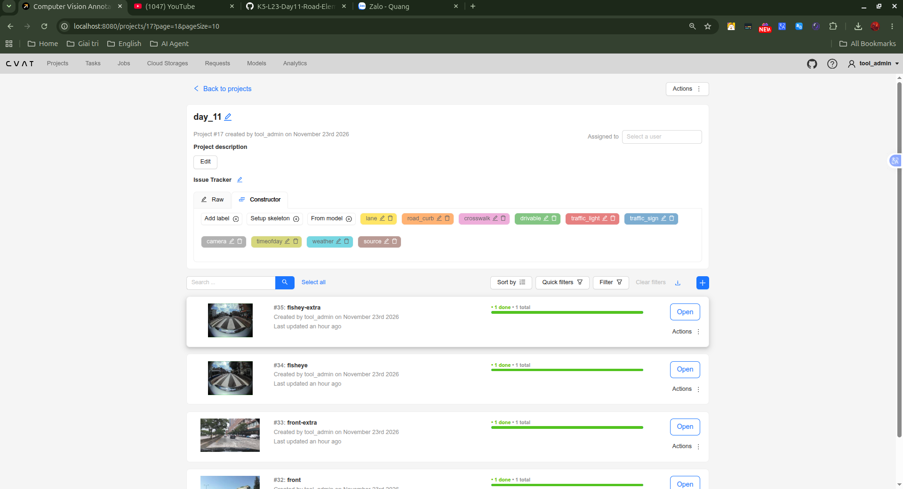
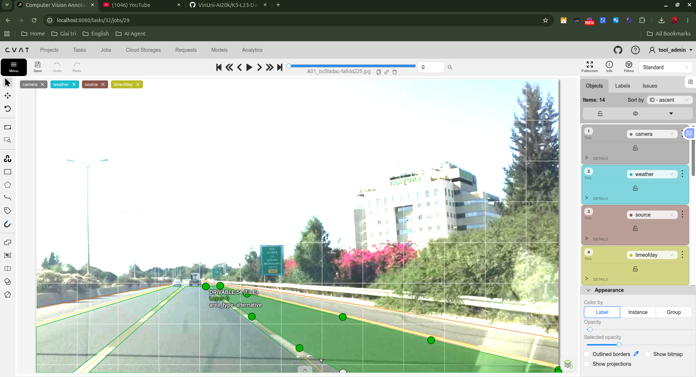
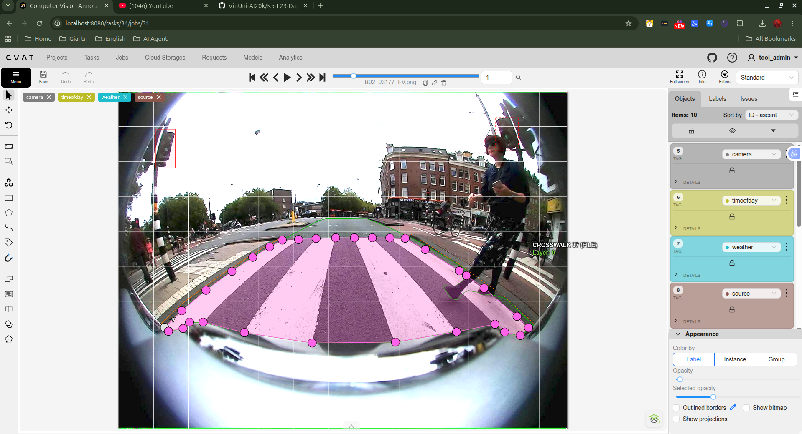

# Báo cáo cá nhân — Ngày 11

Họ tên: Nguyễn Việt Quang  
Mã học viên: 2A202603056  
Phiên bản CVAT (server/about): **2.74.1**
Guideline: Road v1.0  
Lần nộp (`revision` trong manifest): 1  
Thời điểm tạo manifest: 2026-11-23 16:42:03 (giờ Việt Nam)
Số lần nộp lại sau Rework: 0

Manifest dùng để tổng hợp: `submission/NguyenVietQuang-manifest.json`. Hai zip bàn giao trong `submission/` đã gộp export core và extra: front có A01–A16, fisheye có B01–B12. Bốn zip nguồn vẫn được giữ trong `result/`. Manifest này được tạo lại sau khi gộp và byte/hash khớp với hai zip cuối.

## 1. Kiểm project

| Mục | Đúng như guideline Road v1.0? | Ghi chú |
| --- | --- | --- |
| 6 label, đúng kiểu | Tên label khớp project screenshot; metadata hai export xác nhận kiểu hình Road v1.0. | Gồm lane, road_curb, crosswalk, drivable, traffic_light, traffic_sign. |
| Thuộc tính và giá trị | Khớp khai báo Road v1.0 trong metadata hai export; lint không báo label, kiểu shape hoặc giá trị lạ. |  |
| 4 tag ảnh | Đủ trên 28/28 ảnh theo manifest/lint. | `camera`, `timeofday`, `weather`, `source`; tên label thấy trong ảnh Project → Labels. |

Cách vẽ/kết thúc polyline: từ đáy ảnh lên phía xa (gần ra xa); theo hướng dẫn lab, nhấn **N** để kết thúc nét.
Cách đặt tag ảnh theo hướng dẫn lab: ở cấp ảnh, đặt `camera` trước rồi `timeofday`, `weather`, `source`; kiểm giá trị trong Details.
Trạng thái CVAT theo xác nhận của người nộp: cả bốn task front, front-extra, fisheye, fisheye-extra đã **completed**.

## 2. Số lượng đã gán

Số liệu theo lần lint mới nhất trên bốn export nguồn (28 ảnh); các zip bàn giao cuối đã gộp cả core và extra. Manifest tổng hợp có 16 ảnh front và 12 ảnh fisheye.

| Task | Ảnh | lane | road_curb | crosswalk | drivable | traffic_light | traffic_sign |
| --- | ---: | ---: | ---: | ---: | ---: | ---: | ---: |
| front | 12 | 32 | 13 | 3 | 28 | 23 | 16 |
| front-extra (đã làm 4 / 4) | 4 | 9 | 0 | 4 | 10 | 9 | 10 |
| fisheye | 8 | 8 | 11 | 8 | 8 | 2 | 1 |
| fisheye-extra (đã làm 4 / 4) | 4 | 0 | 2 | 5 | 4 | 0 | 0 |
| **Front tổng (A01–A16)** | **16** | **41** | **13** | **7** | **38** | **32** | **26** |
| **Fisheye tổng (B01–B12)** | **12** | **8** | **13** | **13** | **12** | **2** | **1** |

## 3. Bảng ca khó

| Ảnh | Nhãn | Phân vân giữa | Đã chọn | Lý do |
| --- | --- | --- | --- | --- |
| A05 | lane | Thiếu L1 và R1 hay ảnh không có vạch | Coach xác nhận không có vạch nhìn thấy; giữ nguyên, không gán thêm | Coach chấp nhận ngoại lệ QC1-02; không vẽ vạch không nhìn thấy. |
| A06 | lane | Thiếu R1 hay ảnh không có vạch | Coach xác nhận không có vạch nhìn thấy; giữ nguyên, không gán thêm | Coach chấp nhận ngoại lệ QC1-02. |
| A09 | lane | Thiếu R1 hay ảnh không có vạch | Coach xác nhận không có vạch nhìn thấy; giữ nguyên, không gán thêm | Coach chấp nhận ngoại lệ QC1-02. |
| A14 (front-extra) | lane | Thiếu R1 hay ảnh không có vạch | Coach xác nhận không có vạch nhìn thấy; giữ nguyên, không gán thêm | Coach chấp nhận ngoại lệ QC1-02; ảnh thuộc phần extra. |
| A04, A06, A08, A09, A10, A11, A12 | lane | Một vạch đứt / marking đôi bị ghi thành nhiều polyline cùng position | Đã sửa; lint cuối không còn cảnh báo QC1-05 | Giữ một polyline cho một marking; với marking đôi dùng `kind=double`. Cần kiểm trực quan lần cuối. |

Lint hai zip core còn bốn cảnh báo QC1-02; lint cả bốn zip nguồn báo tổng cộng năm, thêm A14 thiếu R1 trong front-extra. Coach xác nhận các vị trí này không có vạch nhìn thấy được và chấp nhận ngoại lệ. Do đó, **không có lỗi gán nhãn được xác nhận trong năm cảnh báo này**; chúng vẫn xuất hiện trong lint dưới dạng cảnh báo hình thức. Lint không báo mã nào khác, nhưng kết quả này không thay thế việc so toàn bộ nhãn với GT.

## 4. Phiếu QC 1 nhận được

Người QC được chỉ định: Nguyễn Trường Giang (`member_id: 2A202603073`).  
Phiếu QC1 peer-review từ Nguyễn Trường Giang chưa được cung cấp trong workspace, nên chưa ghi nhận quyết định review. Riêng với lô của người nộp, coach xác nhận 5 cảnh báo QC1-02 là các vị trí không có vạch nhìn thấy và chấp nhận miễn; đây là xác nhận ngoại lệ, không phải phiếu peer-review.

| Mã lỗi | Số lỗi | Đồng ý? | Đã sửa? |
| --- | ---: | --- | --- |
| QC1-02 ở lô của người nộp | 0 lỗi thực; 5 cảnh báo lint được coach miễn | Đồng ý | Không cần sửa nhãn |
| Phiếu peer-review từ Nguyễn Trường Giang | Chưa nhận được bản phiếu | Chưa xác định | Chưa xác định |

## 5. Kiểm file export

Lint đã mở hai zip bàn giao cuối và đọc 28 ảnh. Manifest ghi `contains_images=false`, `images_unlabelled=0`, `images_all_tags` là 16/16 cho front và 12/12 cho fisheye. Tổng hình: front 157, fisheye 49. `road_check lint` còn 5 cảnh báo QC1-02, tất cả thuộc A05, A06, A09, A14 và đã được coach miễn như mục 3. Lint kiểm tra định dạng và một số dấu hiệu; nó không so toàn bộ nhãn với GT.

| File | Mở lại được? | Số shape ảnh 1 (job / file) | Số shape ảnh 2 (job / file) | Tag camera có trong XML? |
| --- | --- | ---: | ---: | --- |
| `submission/NguyenVietQuang-front.zip` | Có, lint đọc được | A01: 10 | A02: 8 | Có theo manifest; 16/16 ảnh đủ tag |
| `submission/NguyenVietQuang-fisheye.zip` | Có, lint đọc được | B01: 2 | B02: 6 | Có theo manifest; 12/12 ảnh đủ tag |
| `submission/NguyenVietQuang-manifest.json` | Có, tạo lại sau khi gộp extra | front: 16 ảnh / 157 hình | fisheye: 12 ảnh / 49 hình | `contains_images=false`; byte/hash khớp |

## 6. Ảnh chụp màn hình

1. Project → Labels:


2. Ảnh camera trước A01 đã gán nhãn:



3. Ảnh fisheye B02 đã gán nhãn, có polyline cong ở lề đường:



4. Một đoạn XML có `<polyline label="lane">`:

```xml
<polyline label="lane" source="manual" occluded="0" points="1280.00,705.63;902.29,615.85;711.12,568.16;602.17,542.69;554.12,531.00;461.30,509.16" z_order="0" id="0">
  <attribute name="position">R2</attribute>
  <attribute name="style">solid</attribute>
  <attribute name="color">yellow</attribute>
  <attribute name="kind">single</attribute>
</polyline>
```

## 7. Tự đánh giá

Lint báo QC1-02 ở A05, A06, A09 và A14 (front-extra). Coach xác nhận những vạch này không nhìn thấy được và miễn các cảnh báo; giữ nguyên nhãn, không thêm vạch không quan sát được. Đây là kết luận cho các cảnh báo lint này, không phải kết quả chấm toàn bộ lô theo GT.

Nhãn lane đi vào dữ liệu huấn luyện để model học vị trí vạch. Nếu thiếu một vạch nhìn thấy được, model có thể học nhầm rằng ranh giới làn không tồn tại và bỏ sót nó khi suy luận. Ở bốn ảnh trên, coach đã xác nhận vạch không nhìn thấy nên giữ nguyên nhãn là phù hợp.

## 8. (Tùy chọn, buffer) Từ polyline đến đích row-anchor

Chưa thực hiện hoạt động row-anchor tùy chọn.
